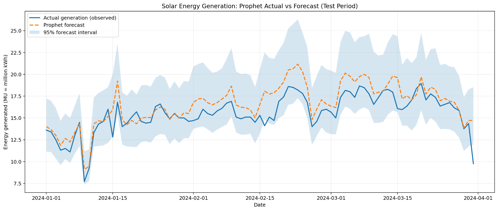
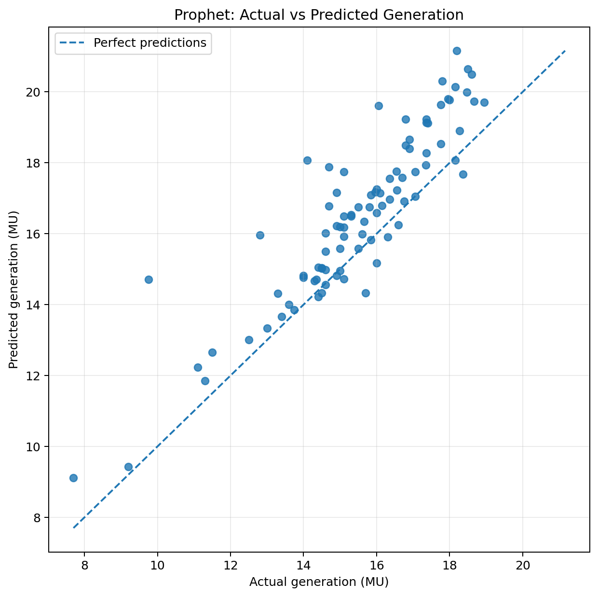
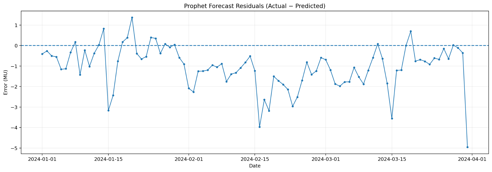
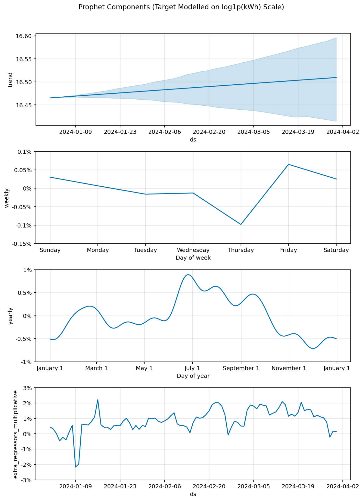
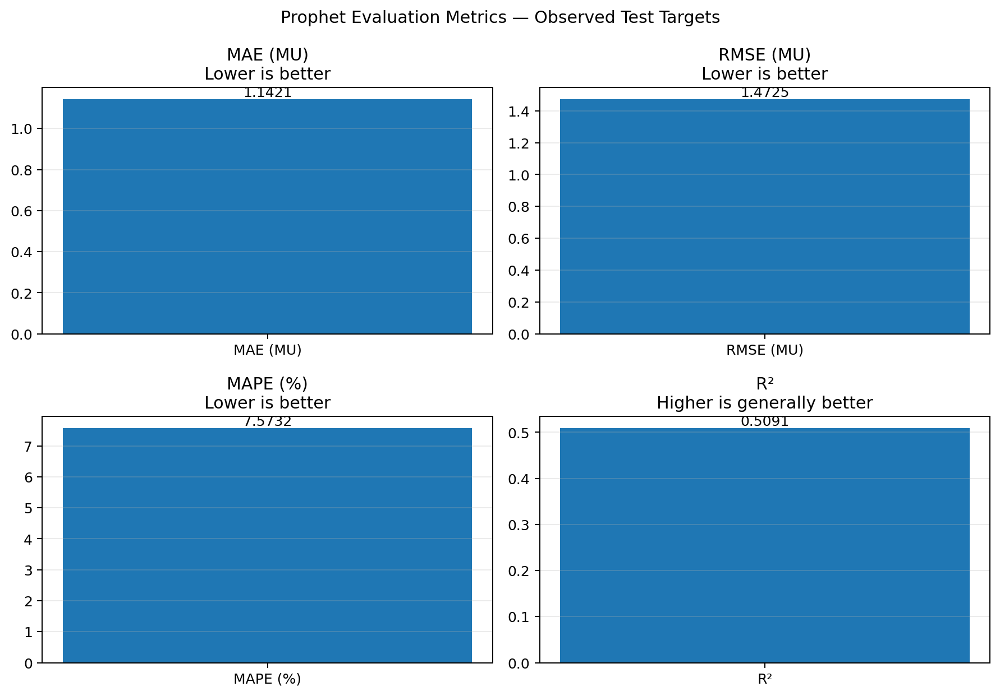
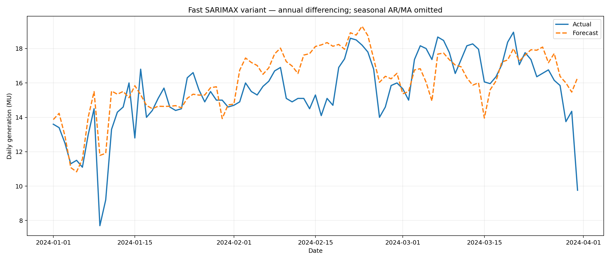

# Solar Energy Generation Prediction

A reproducible time-series forecasting project studying daily solar energy generation from historical generation and weather data. It includes a reconstructed Facebook Prophet workflow, a reconstructed SARIMAX workflow, evaluation metrics, and forecast visualizations.

## Problem statement

Solar energy generation varies with weather, seasonal conditions, and installed capacity. The objective is to analyze daily historical observations and forecast daily generation, then compare predictions with unseen observations.

## Repository contents

- `src/prophet_solar_forecast.py` — Prophet with yearly/weekly seasonality, weather regressors, log1p target transformation, evaluation and plots.
- `src/sarimax_solar_forecast.py` — reconstructed SARIMAX workflow based on a recovered code snippet.
- `notebooks/prophet_forecasting.ipynb` — Google Colab-friendly Prophet notebook.
- `results/` — reconstructed metrics, test-period predictions, configuration, model export, and plots.
- `docs/methodology.md` — methods, assumptions, limitations, and evaluation cautions.
- `requirements.txt` — Python packages needed to run the scripts.

## Headline reconstructed results

Test period: **1 January 2024 – 31 March 2024** (91 daily rows; Prophet scores only originally observed test targets).

| Model/run | MAE (MU) ↓ | RMSE (MU) ↓ | MAPE ↓ | R² ↑ |
|---|---:|---:|---:|---:|
| SARIMAX fast approximation | 1.2332 | 1.6470 | 8.6733% | 0.3859 |
| Facebook Prophet reconstruction | 1.1421 | 1.4725 | 7.5732% | 0.5091 |

MU means one million kWh. Lower MAE/RMSE/MAPE and higher R² are generally preferred when the target and evaluation procedure are the same. This is **not a conclusive model bake-off**: the SARIMAX row is an approximation of the exact seasonal configuration, and the model feature sets differ. Prophet's test-period regressors are from historical weather observations, so this is a retrospective evaluation conditional on weather, not a live future-weather forecast.

## Key plots

### Prophet: actual vs forecast



### Prophet: actual vs predicted scatter



### Prophet: residuals



### Prophet: component plots



### Prophet: metrics



### SARIMAX: actual vs forecast (fast approximation)



## Dataset

The combined workbook covers 1 April 2020 through 31 March 2024 and contains 1,461 daily rows. The scripts expect a workbook named `Complete Data 2020 - 2024 (all features).xlsx` with a `DATE` column and target columns. The raw workbook is intentionally **not included by default**. Before publishing raw data, confirm permission to redistribute it and check its original source/license terms.

## Run in Google Colab

1. Open `notebooks/prophet_forecasting.ipynb` in Google Colab.
2. Run the cells from top to bottom.
3. Upload `Complete Data 2020 - 2024 (all features).xlsx` when prompted.
4. The notebook installs Prophet, fits the model, reports metrics, and creates forecast plots and CSVs.

## Run locally

Create a virtual environment and install dependencies:

```bash
python -m venv .venv
# Windows PowerShell: .venv\Scripts\Activate.ps1
# macOS/Linux: source .venv/bin/activate
pip install -r requirements.txt
```

Run Prophet from the repository root:

```bash
python src/prophet_solar_forecast.py --input "path/to/Complete Data 2020 - 2024 (all features).xlsx" --output-dir results/reproduced_prophet
```

To experiment with all eligible weather/capacity columns as regressors:

```bash
python src/prophet_solar_forecast.py --input "path/to/Complete Data 2020 - 2024 (all features).xlsx" --feature-set all --output-dir results/prophet_all_features
```

Treat the extra-feature run as a separate experiment; do not compare it casually with the report-feature run unless the evaluation setup is held constant.

## Limitations and next steps

- Restore and verify original code and original metric table if they can be recovered.
- Compare models on identical dates, observed labels, target units, and feature availability.
- Add a seasonal-naive baseline and rolling-origin evaluation.
- For practical future prediction, use weather forecasts rather than observed future weather.
- Test a tree-based model such as XGBoost/LightGBM with lagged generation and calendar features only after establishing leakage-safe validation.
- Consider a small Streamlit dashboard after the analysis is reproducible.

## License and attribution

This repository is an educational reconstruction. Add an explicit license only after deciding which code and data you have permission to redistribute. If external datasets are used, retain their required citations and license notices.
